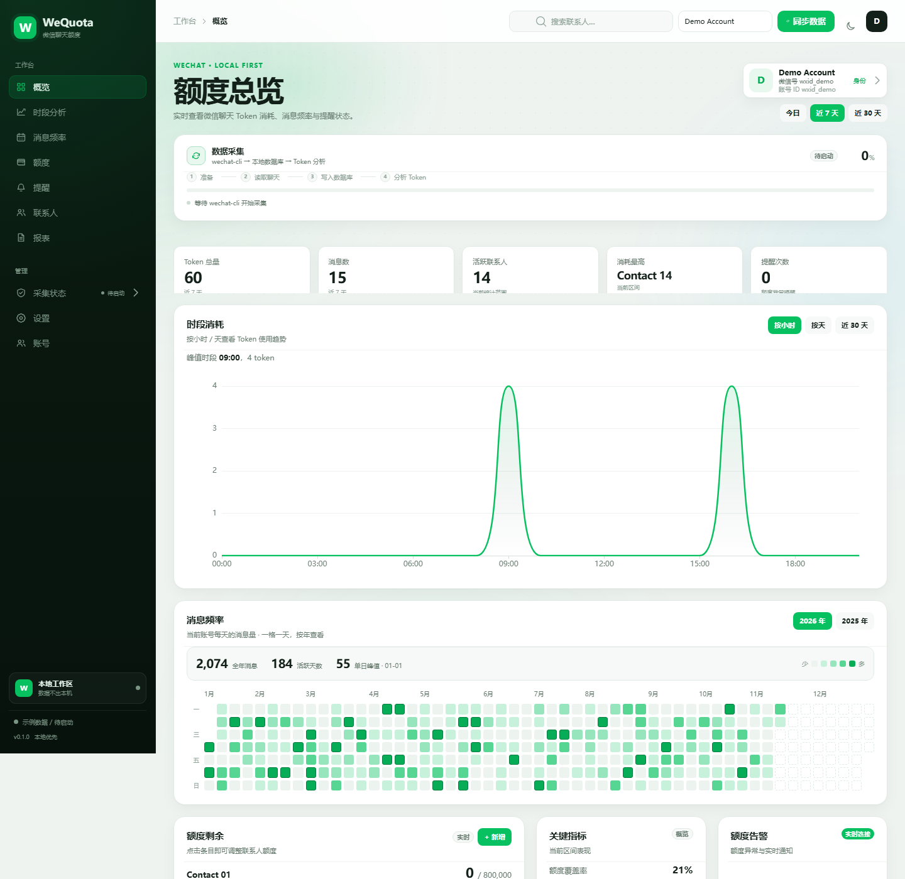
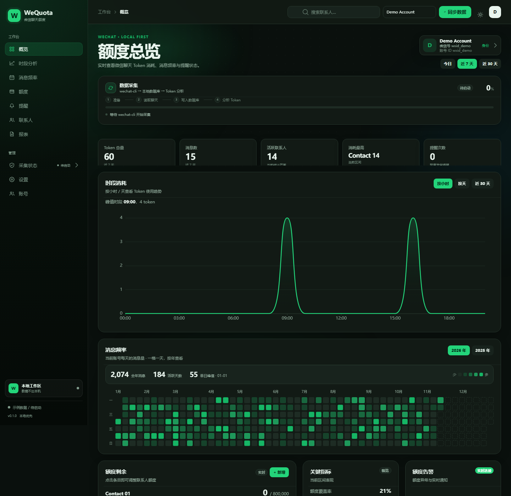
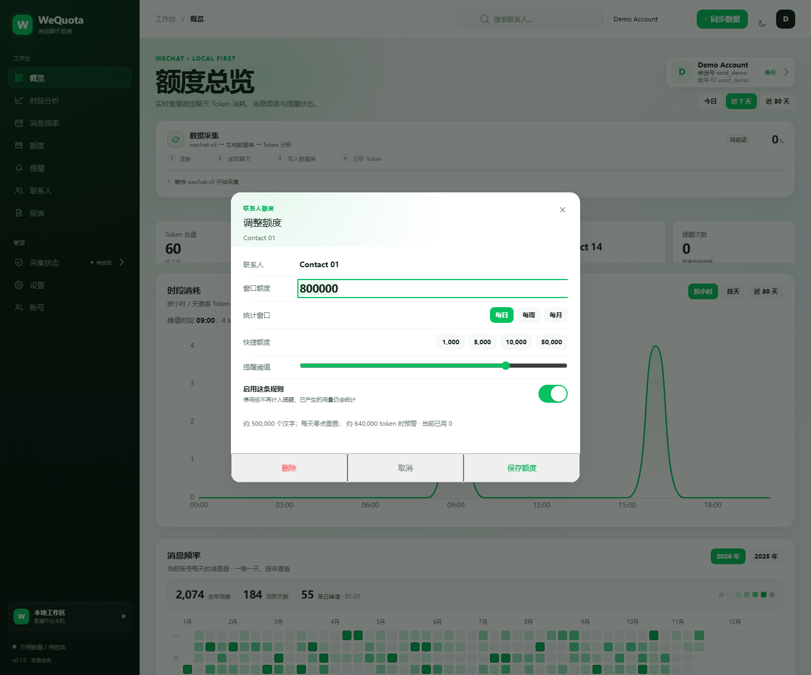
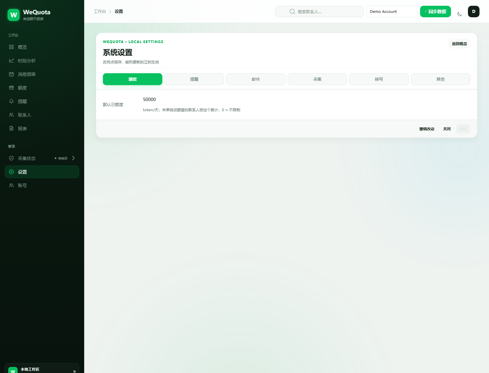

# WeQuota

### 让每一段微信对话，都有可见的 Token 成本。

**WeQuota** 是一个本地优先的微信聊天用量分析工具。它通过外部的 `wechat-cli`
读取已解密的聊天副本，把消息折算成 Token，提供实时大屏、联系人额度、邮件提醒、
年度频率热力图和语音转写，帮助你理解自己的聊天成本，而不是把数据交给云端。

[GitHub](https://github.com/Goose-2950/WeQuota) · [Gitee](https://gitee.com/zhongdongdae/wequota)

[](#)
[](#)
[](#)
[](#)
[](#)
[](LICENSE)

<p align="center">
  
</p>

<p align="center">
  
</p>

## 为什么需要 WeQuota？

聊天工具不会告诉你：

- 这个月你发了多少条消息、消耗了多少 Token；
- 哪个联系人占用了最多注意力；
- 什么时候你的聊天频率开始失控；
- 额度超限时，除了“已读不回”还能做什么。

WeQuota 把“聊了多少、花了多少、该不该停”变成看得见的数据。它不改变微信，
也不上传聊天内容，只在本机完成采集、计量和展示。

## 功能

### 📊 数据大屏

- **额度总览**：Token 总量、消息数、活跃联系人、消耗最高联系人、提醒次数
- **时段分析**：按小时 / 天查看 Token 趋势
- **年度消息频率热力图**：GitHub 贡献图式日历，一格一天，支持年份切换
- **联系人消耗 TOP 10**：快速定位高消耗对话
- **额度卡片**：已用 / 剩余 / 百分比，点击弹出 WeUI 额度对话框
- **全部联系人筛选**：虚拟滚动列表，支持数万联系人
- **浅色 / 深色主题**：基于 WeUI 原生变量，跟随本地切换

### 🎯 额度与提醒

- 每日 / 每周 / 每月额度窗口
- 预警阈值、冷却时间、免打扰时段
- 超限提醒：桌面通知 / 邮件 / 大屏 WebSocket 弹窗
- 支持通过 SMTP 发送 HTML 邮件

### 🧠 本地语音转写

- 可选 `faster-whisper` 本地模型
- 支持将语音消息折算成 Token
- 模型文件直接放在项目内，不依赖启动时下载

### 🔐 本地优先

- 不需要登录 WeQuota 账号
- 无遥测、无云端数据库
- 聊天数据保存在本机 `data/wequota.db`
- `config.json`、`data/`、模型和构建产物默认不进入 Git

### 👥 多账号

- 不同 `account_id` 的数据在同一个本地库中隔离
- 通过稳定身份 `stable_id` 识别同一份微信数据
- 修改微信号 / 昵称不会破坏历史数据
- 支持手动确认合并历史别名

## 界面预览

| 额度弹窗 | 设置页 |
|------|------|
|  |  |

## 架构

```text
┌──────────────────────┐
│  微信 / WeChat 4.x   │
└──────────┬───────────┘
           │ 外部工具只读解密
           ▼
┌──────────────────────┐
│     wechat-cli       │  init / contacts / history
└──────────┬───────────┘
           │ 解密副本（只读）
           ▼
┌──────────────────────┐
│ HuohuoerCollector    │  游标增量 + 全量回填
└──────────┬───────────┘
           │ MessageEnvelope
           ▼
┌──────────────────────┐
│ SyncWorker           │  入库 → 计量 → 额度 → 提醒
└──────────┬───────────┘
           │ SQLite
           ▼
┌──────────────────────┐
│ FastAPI + WebSocket  │  本地 API / 实时告警
└──────────┬───────────┘
           │
           ▼
┌──────────────────────┐
│ Vue 3 + WeUI + GSAP  │  数据大屏
└──────────────────────┘
```

WeQuota **不包含微信数据库解密代码**，不写微信源数据库，只读 `wechat-cli`
已经生成的解密副本。微信登录同步期间，上游刷新副本可能造成短暂锁库；
采集器会自动重试，失败只会跳过当前轮次，不会提前推进游标。

## 技术栈

| 层 | 选型 |
|----|------|
| 采集 | Python 3.11 · `wechat-cli` 外部适配器 |
| 后端 | FastAPI · SQLite · Pydantic |
| 计量 | tiktoken · faster-whisper（可选） |
| 前端 | Vue 3 · Vite · ECharts |
| UI / 动效 | **WeUI 原生组件 + GSAP** |
| 提醒 | WebSocket · 桌面通知 · SMTP 邮件 |

## 快速开始

### 环境要求

- Windows 10/11（当前主要验证平台）
- Python **3.11.x**
- Node.js 20+（仅前端开发 / 重新构建时需要）
- 微信 4.x + [`SarielChin/wechat-cli`](https://github.com/SarielChin/wechat-cli) 0.3.0

### 1. 安装依赖

```powershell
git clone https://github.com/Goose-2950/WeQuota.git WeQuota
cd WeQuota
python -m venv .venv
.venv\Scripts\Activate.ps1

pip install -r requirements.txt
```

### 2. 构建前端

```powershell
cd web
npm ci
npm run build
cd ..
```

构建产物会写入 `wequota/webapp/`，不进入 Git；本地开发时需要先构建一次。

### 3. 配置微信采集

先安装并初始化外部 `wechat-cli`（Windows 建议在管理员终端执行）：

```powershell
wechat-cli init --force
```

然后运行交互式配置：

```powershell
python -m wequota.cli --setup
```

填写：

- `collector.account_id`：本机微信账号标识
- 是否启用实时采集
- 是否首次全量回填
- 邮件 / 桌面通知
- 语音转写模型

### 4. 启动

```powershell
python -m wequota.cli --no-wizard
```

终端会打印本地大屏地址，例如：

```text
http://127.0.0.1:52341
```

打开即可查看数据大屏。

### 常用命令

| 命令 | 作用 |
|------|------|
| `python -m wequota.cli --setup` | 打开配置页 |
| `python -m wequota.cli --setup --reset-data` | 归档旧库并重新全量读取微信 |
| `python -m wequota.cli --no-wizard` | 不进入向导，直接启动 |
| `python -m wequota.cli --import chat.csv` | 导入聊天备份 |
| `python -m wequota.cli --migrate-money` | 回填旧库里的转账 / 红包分类 |
| `python -m wequota.cli --download-model` | 下载本地语音模型 |

## 配置

配置模板见 [`config.example.json`](config.example.json)。

默认运行文件：

```text
config.json          # 本地配置，含 SMTP 凭据，已 gitignore
data/wequota.db      # 本地 SQLite，已 gitignore
data/backups/        # 每日快照
data/logs/           # 运行日志
assets/models/       # 本地语音模型，已 gitignore
```

设置页覆盖六组内容：

- 额度：默认日额度
- 提醒：桌面 / 邮件 / 免打扰 / 冷却
- 邮件：SMTP 服务器、端口、授权码、收件人
- 采集：实时采集、轮询间隔、全量回填、单联系人上限
- 转写：模型规格与状态
- 其他：演示入口、访问令牌、CORS、数据库快照

## 项目结构

```text
wequota/             后端：FastAPI、采集、计量、额度、提醒、SQLite
web/                 前端：Vue 3 + WeUI + GSAP + ECharts
installer/           安装、自检、打包
tests/               后端测试
docs/                架构与使用文档
assets/              tiktoken 缓存；语音模型运行时放入 assets/models
data/                本地运行数据（gitignore）
```

## 开发与测试

```powershell
# 后端
python -m pytest -q

# 前端
cd web
npm run build
```

CI 配置见 [`.github/workflows/ci.yml`](.github/workflows/ci.yml)。

## 隐私与合规

- **本地优先**：默认只监听 `127.0.0.1`，不向外部服务器发送聊天内容。
- **不内置解密能力**：实时采集依赖外部 `wechat-cli`，请自行确认其合法性与安全性。
- **不要提交敏感数据**：`config.json`、`data/`、模型、日志和截图中的真实联系人信息都不要上传。
- **仅供个人学习研究**：请勿用于监控他人聊天或任何侵犯隐私的用途。
- 本项目与腾讯 / 微信官方无关。

## 已知限制

- Windows 已实测；macOS / Linux 尚未完整验证。
- 实时采集需要微信已登录，且外部 `wechat-cli` 能成功提取密钥。
- 首次全量回填会逐联系人读取历史，联系人越多耗时越长；可在设置里关闭或限制回填。
- 语音转写模型体积较大，首次使用需要额外下载或随包放入 `assets/models/`。

## Roadmap

- [ ] 更完整的 macOS / Linux 验证
- [ ] 按稳定账号拆分的 profile 数据目录
- [ ] 更细的增量采集策略（最近会话优先）
- [ ] 额度规则模板与批量导入
- [ ] 大屏截图与演示数据脚本

## 贡献

欢迎提交 Issue / Pull Request。详细流程见 [CONTRIBUTING.md](CONTRIBUTING.md)，
安全问题请先阅读 [SECURITY.md](SECURITY.md)。提交前请确保：

1. 不包含真实 `config.json`、数据库、日志或聊天内容；
2. `python -m pytest -q` 通过；
3. 前端 `npm run build` 通过；
4. 新增功能附带测试或说明。

## License

[MIT](LICENSE) © 2026 WeQuota contributors
